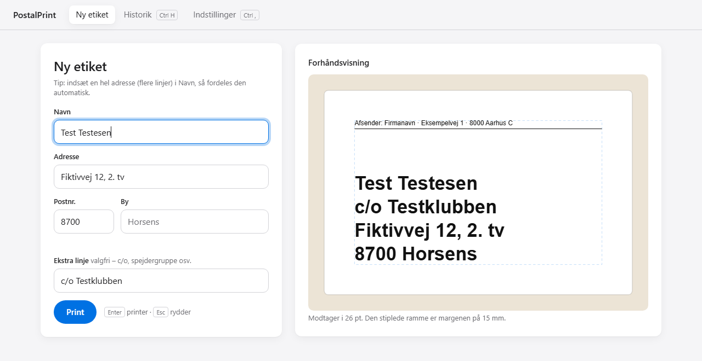
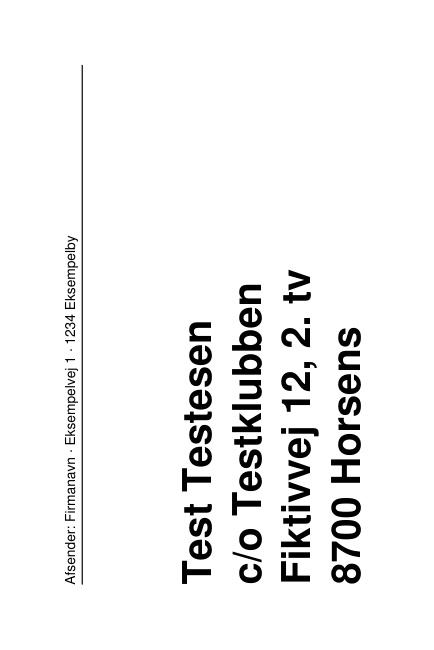

# PostalPrint – address labels in a few keystrokes

A small local Windows app that prints recipient address labels for letters on a 100 × 150 mm thermal label printer, with no handwriting and no print dialog.

**[ Download PostalPrint.exe](../../releases/latest)** – Windows 10/11, nothing to install. See [Getting started](#getting-started-windows).



> The user interface is in Danish because the app is built for Danish domestic mail (PostNord/dao). Code, comments and tests are in English.

## Why

I send around 300 small orders a year as letters, and writing the addresses by hand was slow and error-prone. Commercial shipping tools are built for parcels and barcodes, not plain letters with a stamp. This tool turns typing an address into a printed, validated label in a few seconds.

## Features

- **Keyboard first.** Type the name, then Tab, the street, Tab, the postcode, Enter. The city is filled in from the postcode and skipped by Tab.
- **Paste a whole address.** If you paste a multi-line or comma-separated address into the name field, it is split into the right fields.
- **Two-layer validation**
  - **Offline (blocks printing):**
    - required fields
    - four-digit postcode that actually exists
    - "road name + house number" format, e.g. it catches `12 Fiktivvej` and a postcode typed into the street field
    - characters the printer font cannot print
    - text that cannot fit on the label
  - **Warnings (Enter again to print anyway):**
    - a city that does not match the postcode
    - a possible duplicate within 14 days
    - a name that looks like an address
  - **Online (warnings only):** checks via OpenStreetMap that the address exists, and suggests the right postcode. It is skipped silently when the internet is down.
- **Live preview** that uses exactly the same layout code as the PDF, including automatic font sizing (26 → 14 pt).
- **Silent printing** through SumatraPDF, without scaling. The printer is picked from a list and SumatraPDF is found automatically.
- **Confirm or reprint.** After printing you answer "Did it come out fine?": Enter saves the label to the history, Esc prints it again.
- **History**
  - searchable, grouped by month
  - one-click reprint
  - every printed label kept as a PDF, so it can also be printed manually
- **Safe storage**
  - atomic writes (`tmp` + `os.replace`)
  - a backup copy after every change
  - human-readable JSON



## Tech and architecture

Python 3.12+, Flask, ReportLab, vanilla HTML/CSS/JavaScript (no build step), pytest.

```
src/postalprint/
├── __main__.py        Startup: local server + its own app window
├── paths.py           Where user data lives (next to the .exe, or in the project folder)
├── addresses/         Offline validation, online address check (OpenStreetMap), postcode lookup
├── labels/            Label layout (shared by PDF and live preview) and PDF rendering
├── printing/          Print modes: open file / browser dialog / SumatraPDF
├── storage/           Config, monthly history files, label PDFs, backups
└── web/               Flask routes + the single-page UI (templates/, static/)
tests/                 Same layout as src/, one test module per domain
scripts/               build_exe.py (Windows .exe) and build_postnumre.py (postcode list)
.github/workflows/     Tests on every push; builds and publishes the .exe on version tags
```

Only `web` knows about Flask. The `addresses`, `labels`, `printing` and `storage` packages are plain Python, so they are tested in isolation and could be reused, for example for a future WooCommerce integration. The full design is in [docs/SPEC.md](docs/SPEC.md) (Danish).

## Getting started (Windows)

### Option 1: download the program (recommended)

1. Download **`PostalPrint-windows.zip`** from the [latest release](../../releases/latest) and unzip it to a permanent folder, e.g. `Documents\PostalPrint`.
2. Double-click **`PostalPrint.exe`**. Windows may warn that the app is unsigned: click "More info" → "Run anyway".
3. The app opens in its own window. Enter the sender address under Settings.
4. Without a label printer, keep the print mode "Åbn PDF'en": each label opens as a PDF instead.

Your data is saved in a `data` folder next to `PostalPrint.exe`. A short Danish guide (`VEJLEDNING.txt`) is included in the zip.

### Option 2: run from source

1. Install [Python 3.12+](https://www.python.org/downloads/) and tick "Add python.exe to PATH".
2. Clone the repo and double-click **`start.bat`**. On the first run it creates a virtual environment, installs the app and adds an **PostalPrint** shortcut to the desktop.

To stop the app, close its (minimised) console window. Starting it again while it is already running just opens the window.

### Printer setup

Install [SumatraPDF](https://www.sumatrapdfreader.org/download-free-pdf-viewer) (free; it handles the silent printing). In the printer driver, set the paper size to 100 × 150 mm portrait and scaling to 100 %. In the app, choose **Direkte til labelprinteren** and your printer, then use **Print kalibreringsetiket** and measure it with a ruler: the frame must sit exactly 15 mm from the edge. If the text is upside down, switch the rotation between 90° and 270°.

## Development

```
python -m venv .venv
.venv\Scripts\pip install -e .[dev]
.venv\Scripts\python -m postalprint --debug       # auto-reload; --data-dir lets you use test data
.venv\Scripts\pytest                              # run all tests
.venv\Scripts\python -m postalprint.labels.pdf    # render sample PDFs without Flask or a printer
.venv\Scripts\python scripts\build_postnumre.py  # refresh the postcode list
.venv\Scripts\python scripts\build_exe.py        # build dist\PostalPrint.exe locally
```

In Settings, "Åbn PDF'en" mode opens each label in the default PDF viewer instead of printing, so you can develop without a printer.

### Releasing a new version

Bump `version` in `pyproject.toml` and `src/postalprint/__init__.py`, then push a tag:

```
git tag v1.0.0
git push origin v1.0.0
```

GitHub Actions runs the tests, builds `PostalPrint.exe` with PyInstaller and attaches it (plus a zip with a Danish guide) to a new release. The .exe is not committed to the repository.

## Privacy

All data stays on the local machine in `data/`, which is excluded from Git. That covers the history, label PDFs, backups and the sender address. The server only listens on `127.0.0.1`, request logging is off, and the UI loads nothing from the internet. Old history and backups are never deleted automatically, so delete them yourself when you no longer need them.

The optional online check sends only the road, house number and postcode to OpenStreetMap, never the recipient's name. It can be turned off in Settings.

## Data sources

- Postcodes: [GeoNames](https://www.geonames.org/) postal code data, licensed under [CC BY 4.0](https://creativecommons.org/licenses/by/4.0/).
- Address check: [OpenStreetMap Nominatim](https://nominatim.org/), data © OpenStreetMap contributors, [ODbL](https://www.openstreetmap.org/copyright).

## License

[MIT](LICENSE) © 2026 Tobias Elkjær Flugt. The bundled postcode list (`src/postalprint/addresses/postnumre.json`) remains under GeoNames' CC BY 4.0 license.
